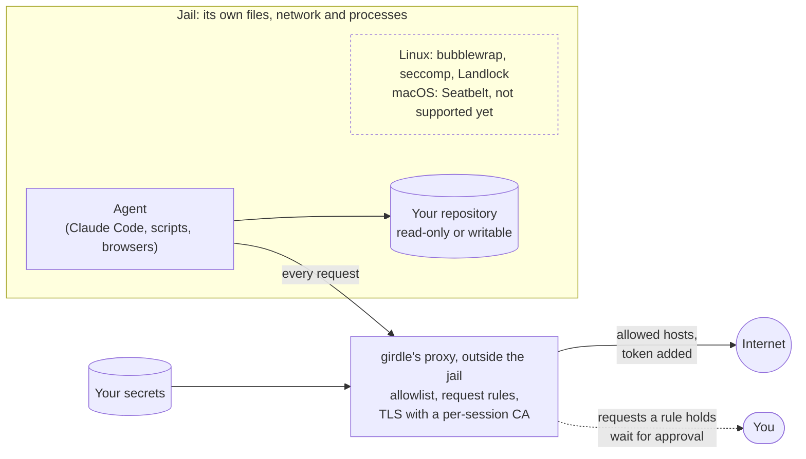

# Girdle of Melian

girdle runs a coding agent, such as Claude Code, in a jail on a Linux host, such as a workstation or a server. The jail has its own files, network and processes. A proxy outside the jail decides which hosts the agent reaches and adds credentials to requests.

Pre-alpha. Linux only.

## Install

```sh
nix profile install github:fnune/girdle
girdle doctor
```

girdle is one static binary that bundles bubblewrap. It needs a Linux kernel with unprivileged user namespaces, and podman for containers. With home-manager, import `girdle.homeManagerModules.default` and write profiles as nix. The [install guide](docs/install.md) has both ways, the credentials to create and how to find the hosts a build needs.

## Quick start

A profile says what one kind of work can reach. Save this as `~/.config/girdle/profiles/my-app.toml`:

```toml
description = "My app: Go API and React frontend"
modules = ["base", "go", "node", "playwright", "github", "claude"]

# The agent changes the checkout in place. git's config and hooks stay
# read-only.
[[mounts]]
path = "~/Development/my-app"
mode = "write"

# Hosts the build and tests need beyond what the modules allow.
[egress]
allow = ["api.stripe.com"]

# A token for the github module. girdle adds it to gh and git requests.
[secrets.github]
command = ["rbw", "get", "github-my-app"]

[limits]
memory = "16G"
```

Then run the agent, naming the profile:

```sh
cd ~/Development/my-app
girdle run --profile my-app -- claude
```

The modules hold the usual hosts, caches and rules for a toolchain: `go` allows the Go module proxy, `github` allows reads and routine pull request work and holds merges, releases and pushes for approval. [Configuration](docs/configuration.md) lists every key.

## What girdle is for

girdle is for running coding agents on a host that you work on, with that host's tools, repositories and logins, without approving each step of the agent's work.

By design, girdle isolates less than sandboxes such as [NVIDIA OpenShell](https://github.com/NVIDIA/OpenShell), which run the agent in a container or a virtual machine with only its own image. girdle shares the host's toolchain, checkouts and kernel with the agent, so that the agent can work like you do.

girdle protects you from an agent that does something you did not ask for, for example after a prompt injection in a web page, an issue or a dependency. In a girdle session, the agent cannot:

- read your home directory, your other projects, your SSH keys or your tokens.
- read the credentials that girdle adds to its requests.
- reach a host that the profile does not name, your local network or a cloud metadata service.
- change files that git runs outside the jail, such as hooks and config.
- make a request that a rule holds for approval, until you approve it. The rules come from the profile and its modules. For example, the `github` module holds merges, releases and pushes.
- approve its own requests.

girdle does not protect you from:

- an agent that sends the project to a host that the profile allows. Allow only the hosts that the task needs.
- operations that an allowed program, such as `gh`, can do under the rules, for example a comment on GitHub.
- a bug in the Linux kernel. The jail shares the kernel with the host.

[Security limits](docs/security-limits.md) gives the full list and the reasons.

## How it works



| Part            | What it does                                                                                                                                                                                                                                                                   |
| --------------- | ------------------------------------------------------------------------------------------------------------------------------------------------------------------------------------------------------------------------------------------------------------------------------ |
| Files           | bubblewrap mounts the system read-only. The home directory, `/run`, `/tmp`, `/var` and `/opt` are empty. The paths that the profile names are mounted at the same paths, read-only, writable or hidden. In a writable repository, git's config, hooks and info stay read-only. |
| Kernel          | seccomp refuses namespaces, mounts, `ptrace`, `bpf`, `io_uring`, kernel modules and terminal input injection. Landlock limits writes to the writable mounts.                                                                                                                   |
| Network         | The jail has only a loopback interface. Programs reach other hosts through the proxy, with `HTTPS_PROXY`. The proxy allows the hosts that the profile names and refuses other hosts, private addresses and metadata addresses. Each decision goes to an audit log.             |
| Credentials     | For a host with an `[[http]]` entry, the proxy terminates TLS with a per-session CA, adds the credential to requests from the programs that the profile names, and applies the request rules: allow, approve or deny.                                                          |
| Approvals       | A request that a rule holds waits until you allow or deny it in a desktop notification or with `girdle approvals`, for example over SSH on a server. Claude Code's permission prompts use the same queue.                                                                      |
| Commit signing  | An SSH agent with an agent-only key signs git commits. It refuses other uses of the key.                                                                                                                                                                                       |
| Containers      | A podman service runs in a separate user namespace and shares the jail's network. A broker checks each API call: mounts, privileges, images.                                                                                                                                   |
| Resource limits | Each session runs in a systemd user scope with a task limit and a memory limit.                                                                                                                                                                                                |
| Looking inside  | `girdle exec` runs a command in a running session. `girdle forward` makes a port in the jail reachable on the host's localhost.                                                                                                                                                |

## Docs

- [Install](docs/install.md): setup, credentials, Claude Code in the jail, known issues
- [Configuration](docs/configuration.md): every profile and module key
- [Security limits](docs/security-limits.md): what girdle leaves open, and why

## Development

`nix develop` gives the toolchain. `just check` runs formatting, lint and unit tests, and `just test-integration` runs the tests that start real jails. [Engineering principles](docs/engineering.md) describes how the code is written.
