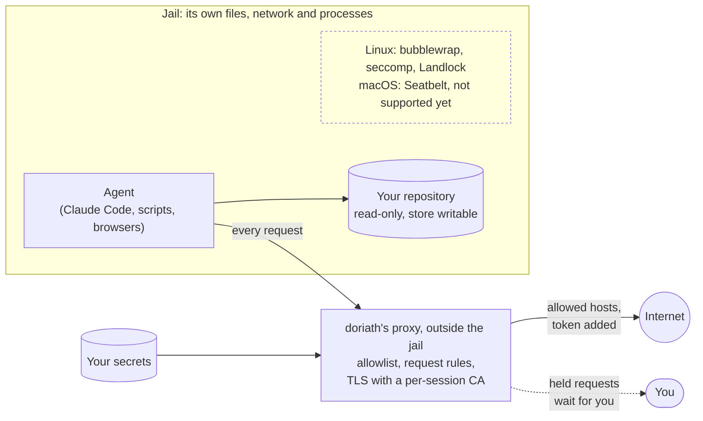

# Doriath

doriath runs a coding agent, such as Claude Code, in a jail on a Linux workstation or server. The jail has its own files, network and processes. A proxy outside it decides which hosts the agent reaches and adds credentials to requests.

Pre-alpha. Linux only.

## Install

```sh
nix profile install github:fnune/doriath
doriath doctor
```

doriath is one static binary that bundles bubblewrap. It needs unprivileged user namespaces, and podman for containers. The [install guide](docs/install.md) also covers home-manager, credentials and Claude Code.

## Quick start

A profile says what one kind of work can reach. Save this as `~/.config/doriath/profiles/my-app.toml`:

```toml
description = "My app: Go API and React frontend"
modules = ["base", "vcs", "docs", "go", "node", "github", "claude"]

# Hosts the build needs beyond what the modules allow.
[egress]
allow = ["api.stripe.com"]

# The token the github module adds to gh and git requests.
[secrets.github]
command = ["rbw", "get", "github-my-app"]
```

Then run the agent from the repository:

```sh
cd ~/Development/my-app
doriath run --profile my-app -- claude
```

The agent sees the repository read-only and commits in worktrees of its own. Modules hold the hosts, caches and rules of a toolchain: `go` allows the Go module proxy, and `github` holds merges, releases and pushes for your approval. [Configuration](docs/configuration.md) lists every key.

## Purpose

doriath lets coding agents work on your own host, with its tools, repositories and logins, without you approving each step. It isolates less than sandboxes such as [NVIDIA OpenShell](https://github.com/NVIDIA/OpenShell), which run the agent in a container or virtual machine with an image of its own: doriath shares your toolchain, checkouts and kernel, so the agent works as you do.

It protects you from an agent that does what you did not ask for, for example after a prompt injection. The agent cannot:

- read your home directory, other projects, SSH keys or tokens, or the credentials doriath adds to its requests.
- reach a host the profile does not name, your local network or a cloud metadata service.
- change your checkout or anything git runs, unless the profile makes it writable.
- make a request that a rule holds, such as a merge, until you approve it, and it cannot approve its own requests.

It does not protect you from an agent that sends the project to a host the profile allows, from what an allowed program such as `gh` may do under the rules, or from a kernel bug. [Security limits](docs/security-limits.md) has the full list.

## Architecture



| Part        | What it does                                                                                                                                                                                                               |
| ----------- | -------------------------------------------------------------------------------------------------------------------------------------------------------------------------------------------------------------------------- |
| Files       | The system is read-only, and the home directory, `/run`, `/tmp` and `/var` start empty. The repository you start in is read-only, with its git and jj store writable. Other paths appear only when the profile names them. |
| Kernel      | seccomp refuses namespaces, mounts, `ptrace`, `bpf`, `io_uring` and terminal injection. Landlock limits writes.                                                                                                            |
| Network     | The jail has only loopback. The proxy allows the hosts the profile names, holds others for your approval, and refuses private and metadata addresses. Every decision goes to an audit log.                                 |
| Credentials | For an `[[http]]` host, the proxy terminates TLS, adds the credential for the programs the profile names, and applies request rules.                                                                                       |
| Approvals   | Held requests wait for you in a desktop notification, a page in your browser, or `doriath approvals`. An allow lasts at most for the session.                                                                              |
| Extras      | An SSH agent that only signs commits, a podman service behind a broker that checks each API call, systemd limits, and `doriath exec` and `doriath forward` to look inside.                                                 |

## Docs

- [Install](docs/install.md): setup, credentials, running agents, Claude Code
- [Configuration](docs/configuration.md): every key, mounts, repositories, approvals
- [Security limits](docs/security-limits.md): what doriath leaves open, and why

## Development

`nix develop` gives the toolchain. `just check` runs formatting, lint and unit tests, and `just test-integration` the tests that start real jails. [Engineering principles](docs/engineering.md) describes how the code is written.
