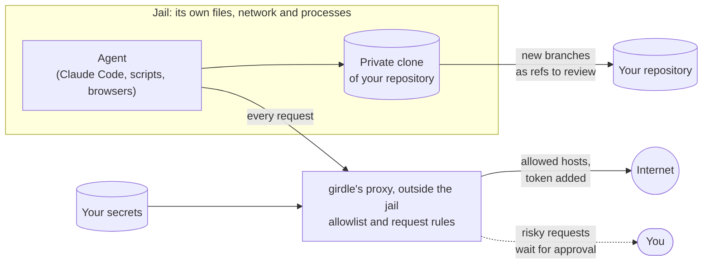

# Girdle of Melian

Run coding agents in a jail that shows them only what their task needs: the right directories, hosts, credentials and sockets, and nothing else from your machine.

```sh
cd ~/Development/my-project
girdle run -- claude
```

Pre-alpha. Linux only.



The agent works on a clone in a jail with no network of its own. Everything it sends goes through girdle's proxy, which reaches only the hosts the profile allows and adds credentials the agent never sees. Risky requests wait for you, and the agent's commits reach your repository only as refs you review.

## What the agent gets

- **Its own view of the files.** The home directory, `/run`, `/tmp`, `/var` and `/opt` are empty. Only the paths the profile names come back, at their real paths, so tools keep working. A repository becomes a private clone, so nothing the agent writes reaches the checkout your editor and git use.
- **A network with an allowlist.** The jail has no network of its own. Its only way out is a proxy that tunnels to allowed hosts and refuses the rest. Every decision goes to an audit log.
- **Credentials it never sees.** For hosts such as GitHub, the proxy terminates TLS with a CA that only the jail trusts, adds your token to each request, and holds risky requests, such as merging or releasing, until you approve them.
- **Commit signing, and nothing else.** An agent-only SSH key signs commits as you, and refuses SSH logins.
- **Containers beside it.** A podman service in its own user namespace sees the same paths as the jail and shares its network, so containers go through the proxy too.
- **One place for approvals.** Requests show as desktop notifications with buttons, and in `girdle approvals`. Claude Code's permission prompts go there too.

## How it is built

One static Go binary. It bundles bubblewrap and implements the proxy, the CA, the signing agent and the approval relay itself, so the only requirements are a Linux kernel with unprivileged user namespaces and, for containers, podman.

## Docs

- [Install](docs/install.md)
- [Configuration](docs/configuration.md)
- [Engineering principles](docs/engineering.md)
